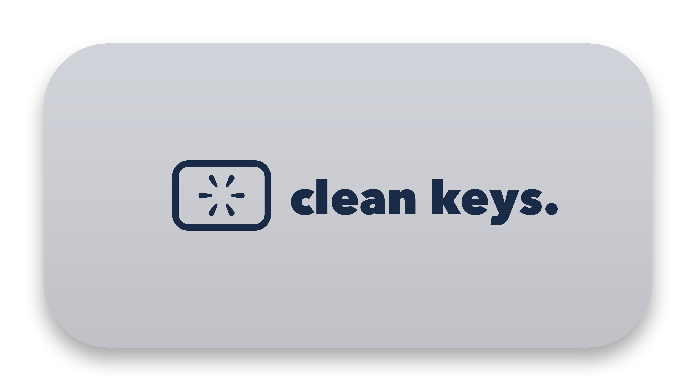

<div align="center">
  
  <br><br>
  
  [](https://monolabapps.gumroad.com/l/cleankeys)
  [](https://github.com/alaska14/cleankeys/releases/latest)
  [](https://alternativeto.net/software/cleankeys/)
  [](#option-2-homebrew-free)
</div>

<br>

# CleanKeys

> **Distraction-free volume & brightness on macOS. Fully headless.**

Ever been immersed in a movie, video edit, live stream, or fullscreen game, only to be interrupted by a giant semi-transparent square in the center of your screen every time you adjust volume or screen brightness?

**CleanKeys** eliminates those intrusive HUD popups completely, giving you seamless, uninterrupted control over your Mac's hardware media keys.

---

## ✨ Key Features

- 🎬 **Movie Night & Fullscreen Immersion:** Change volume and brightness while watching movies, shows, or streams without distractive on-screen overlays breaking your focus.
- 🍃 **Fully Headless & Menu-Bar-Free:** Most utilities clutter your top menu bar with yet another icon. CleanKeys is completely headless—zero menu bar items, zero Dock icon. It simply works silently in the background.
- 🔇 **Silences All Intrusive Popups:** Suppresses on-screen volume, mute, display brightness, and keyboard illumination HUD banners.
- 🎮 **Pro Workflow & Gaming:** Ideal for full-screen games, video editing (Final Cut Pro, Premiere, DaVinci Resolve), and keynote presentations where popups ruin the visual.
- ⚡ **Zero Battery Drain (0.0% CPU):** Written in lightweight native AppKit with zero dependencies, frameworks, or Electron bloat.
- 🛑 **Frictionless Control:** Wondering how to quit or pause without a menu bar icon? Simply open CleanKeys from Applications or Spotlight anytime—it will gracefully detect it is already running and pop up a clean 1-click dialog: *Keep Running* or *Quit CleanKeys*.

---

## 🔒 Security & Privacy Guarantee

Because CleanKeys intercepts hardware aux keys, macOS asks for **Accessibility Permission** on first launch.

Here is our explicit privacy promise:
1. **Zero Text Keystroke Logging:** CleanKeys uses Apple's native `CGEventTap` strictly filtered to auxiliary media keys (`NX_KEYTYPE_SOUND_UP`, `SOUND_DOWN`, `MUTE`, `BRIGHTNESS_UP`, `BRIGHTNESS_DOWN`, `ILLUMINATION_UP`, `ILLUMINATION_DOWN`). It **never** reads, monitors, or logs your text keystrokes or passwords.
2. **Zero Network Connections:** CleanKeys contains **zero networking code**. It does not connect to any servers, makes zero telemetry or analytics calls, and operates 100% locally and offline on your machine.
3. **Open Verification:** You can inspect network activity via macOS Little Snitch or Activity Monitor. CleanKeys uses 0 KB of network bandwidth forever.

---

## 📦 Installation

### Option 1: Homebrew (Free)
```bash
brew tap alaska14/tap
brew install --cask cleankeys
```

### Option 2: Download Free DMG
Download the signed DMG directly from **[GitHub Releases](https://github.com/alaska14/cleankeys/releases/latest)**.

### Option 3: Support Development on Gumroad
If you love CleanKeys and want to support indie Mac development, you can pay what you want on **[Gumroad (monolabapps.gumroad.com/l/cleankeys)](https://monolabapps.gumroad.com/l/cleankeys)**!

---

## 💬 Feedback & Feature Requests

Have a suggestion, found an edge case, or want to report a bug?
- **[Open an Issue](https://github.com/alaska14/cleankeys/issues)** right here on GitHub.
- Or reach out directly at **[monolabapps.gumroad.com](https://monolabapps.gumroad.com)**.

Crafted with care by **MonoLab**.
